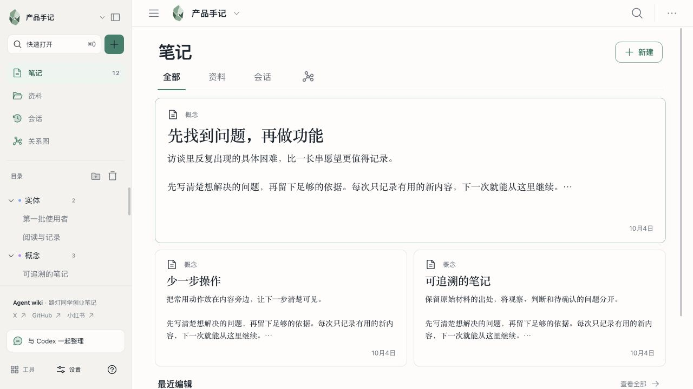
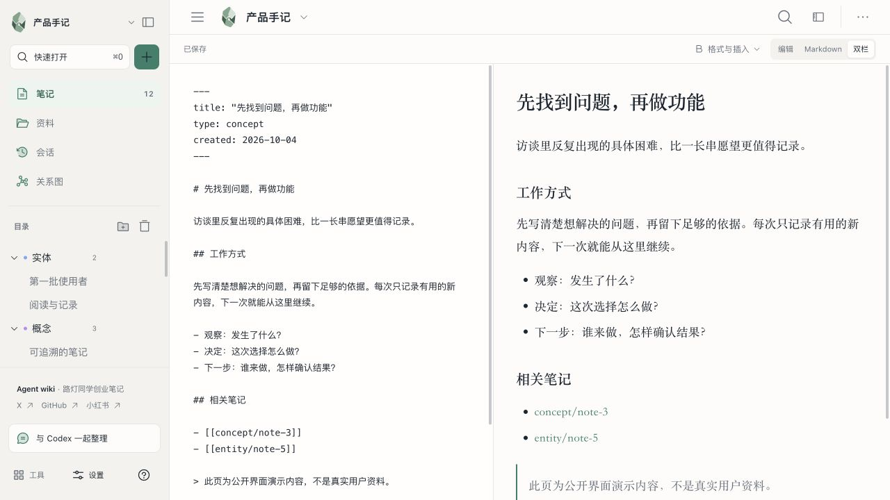
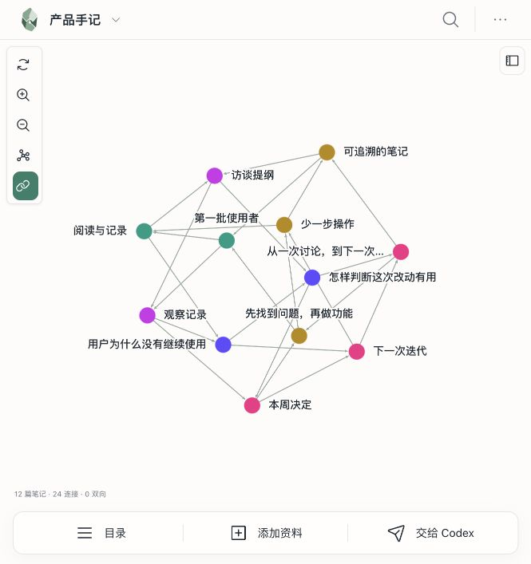
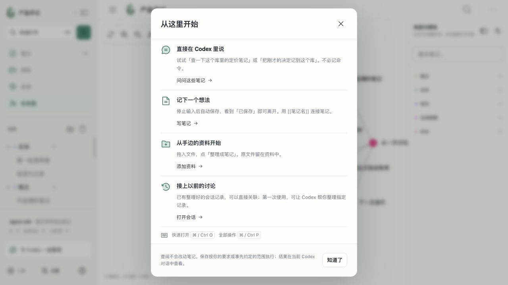

<div align="center">
  
  <h1>Agent wiki</h1>
  <p><strong>Keep your sources, notes and decisions ready for the next conversation.</strong></p>
  <p>A Codex plugin · Local Markdown files · Chinese and English UI</p>
  <p><a href="https://github.com/streetlightstartupnotes/agent-wiki/releases">Download</a> · <a href="#get-started">Get started</a> · <a href="README.md">中文</a></p>
</div>



Useful decisions often disappear into chat history. Agent wiki turns the material you choose into linked Markdown notes, so you can find the reasoning, update it and continue working in Codex.

Created by **[路灯同学创业笔记](https://github.com/streetlightstartupnotes)** · [X](https://x.com/LDstartupnotes) · [小红书](https://www.xiaohongshu.com/user/profile/63fd97c1000000001400d0ea)

> **Version 0.2.2**, distributed through GitHub. **Not listed in OpenAI's official plugin directory.** Screenshots show the actual UI running in a browser preview with purpose-written public demo notes. They contain no personal conversations and do not demonstrate AI execution in the browser.

## What you can do

| Your task | In Agent wiki |
| --- | --- |
| Pick up a previous discussion | Save confirmed decisions, their reasoning and unfinished work |
| Make source material useful | Retain originals, organize notes and connect supported references |
| Write and read side by side | Markdown, rich-text and split editing with autosave |
| Explore related ideas | Backlinks, categories, graph search and related pages |
| Continue with Codex | Send the selected library and note into the current conversation |
| Use past conversation knowledge | Explicitly select sources and link or rebuild verified records |

Also includes note search, outlines, tables, attachments, research records, link checks, tasks and recoverable deletion. Open existing Wiki libraries or import ordinary Markdown / Obsidian folders. Ordinary Markdown imports preserve the original folder and create a copy.

## See it in use

### Write with the result in view

Edit Markdown beside its rendered content, or switch to a single editor. The saved state stays visible. Revision conflicts preserve your draft so you can compare before merging.



### Follow the connections

Colors distinguish note types. Click a node to inspect its relationships, double-click to open the note, filter types or search by title. You can ask Codex about a selected note. The layout adapts to the panel width.



### Start with something useful

Write an idea, add a document, ask about your notes or connect earlier conversations. The in-app guide provides a direct starting point for each.



## Get started

### 1. Check the requirements

Use a Codex host that supports plugins, local MCP servers and MCP Apps panels. Install **Python 3.9+, Ruby and WEBrick**. Choose a local data folder outside the plugin installation directory.

```sh
python3 --version
ruby --version
ruby -rwebrick -e 'puts WEBrick::VERSION'
```

If WEBrick is missing, install it in your Ruby environment with `gem install webrick`. The prebuilt package does not require Node.js/npm. Full usage has primarily been checked on macOS; other platforms still need validation.

### 2. Install

With a Codex CLI that supports the `plugin` commands:

```sh
codex plugin marketplace add streetlightstartupnotes/agent-wiki
codex plugin add llm-wiki@llm-wiki-local
```

Alternatively, download the ZIP from [Releases](https://github.com/streetlightstartupnotes/agent-wiki/releases), extract the `agent-wiki` folder, and add its actual absolute path:

```sh
codex plugin marketplace add /absolute/path/to/agent-wiki
codex plugin add llm-wiki@llm-wiki-local
```

Reload the plugin or restart Codex and start a new conversation if tools do not appear. The product is named **Agent wiki**; `llm-wiki` and `llm-wiki-local` remain internal identifiers for existing installation compatibility.

### 3. Open your library

Ask Codex: **“Open Agent wiki.”** Choose a storage folder, then create a library or open an existing one. Change the interface language in **Settings → General**. This does not translate your notes.

Try:

- “Find repeated problems in this library's interview notes and cite the sources.”
- “Save the decisions we just confirmed in this library, including the reasoning and open questions.”
- “Organize these documents in this library, retain the originals and link relevant existing notes.”
- “Check this library for broken links. Read the related notes before repairing them.”

## How it works with Codex

**MCP Apps** provides the interface, local **MCP tools** handle reads and writes, and ten bundled **Skills** guide library setup, ingestion, research, capture, maintenance and conversation knowledge workflows. Requests from a selected note include its library and page context.

**Sent does not mean saved.** A panel request runs in the current Codex conversation; check that conversation for its result. The editor's saved indicator confirms an editor save.

A default library enables scoped lookups across conversations; it does **not** collect or save every conversation. For task-end capture, explicitly agree on the destination, scope and exclusions, and keep that agreement visible in the current conversation. This is not an unattended background service.

Conversation workflows integrate [Agent Session Knowledge Base v0.6.0-rc.2](https://github.com/streetlightstartupnotes/agent-session-knowledge-base-skill/releases/tag/v0.6.0-rc.2). Reader retrieves verified records; Rebuilder organizes selected sources. Installation does not start history scanning. Generated evidence stays separate from editable Wiki notes.

## Data and limitations

- Notes and sources live in the local folder you choose, using ordinary files.
- No hosted knowledge service or plugin-owned telemetry. **Content sent to Codex is processed under your Codex account settings: local storage is not offline AI.**
- Writes require an explicit destination and authorized scope. Revision checks reject stale overwrites; deleted notes can be restored from the library trash.
- External images are blocked by default; specific HTTPS origins can be allowed.
- This is a local stdio MCP plugin, not a production HTTP MCP service.
- Multiple macOS regression rounds and some real Codex tool workflows have been checked. All operating systems, document formats, large graphs, natural-language trigger rates and panel-to-model combinations have not been exhaustively validated.

Read the [privacy notice](PRIVACY.md). Report problems through [Issues](https://github.com/streetlightstartupnotes/agent-wiki/issues), with your OS, Codex version, steps and a sanitized error. Do not upload private notes, raw conversations or credentials.

## Source and build

`plugin.json` contains plugin metadata; `mcp.json` starts the local server. The Wiki runtime and React UI live in `skills/llm-wiki/`. Other `llm-wiki-*` folders contain task workflows; Reader and Rebuilder have their own skill directories. Screenshots are in `docs/images/`.

The MCP adapter uses Python and local file operations use Ruby. The distribution includes corresponding source, build commands, lockfiles and third-party licenses.

```sh
cd skills/llm-wiki/assets/workspace
npm ci --ignore-scripts
npm run check
```

Node.js/npm and network access are needed only for frontend development. The public distribution excludes development fixtures and private audit logs. `check` builds the frontend and checks JavaScript syntax; it is not a full end-to-end test suite.

## License and origins

Released under **GPL-3.0**. The UI and parts of the workflow originate from OpenClacky LLM Wiki, with applicable licenses and notices retained. Bundled Session Skill copies have an additional GPL-3.0 grant; this does not change the standalone repository's license.

See [LICENSE](LICENSE), [LICENSING](LICENSING.md) and [third-party notices](licenses/INDEX.md). Agent wiki is an independent project, not an official OpenAI product or an approved directory listing.

[Release notes](RELEASE-NOTES.md) · [Support](SUPPORT.md) · [中文](README.md)
